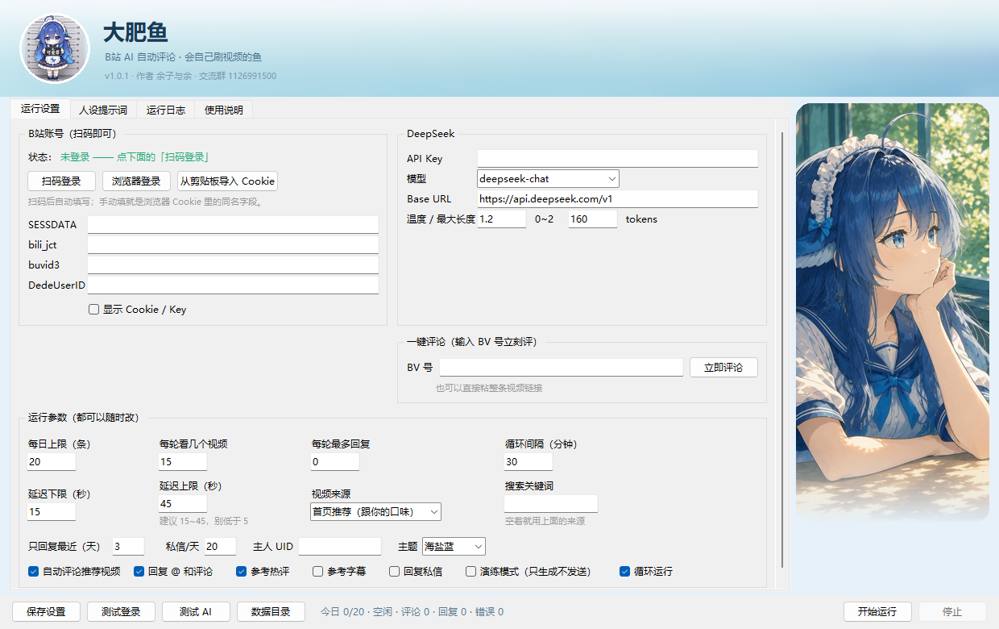

# 🐟 大肥鱼 · B站 AI 自动评论

一个带图形界面的 B站自动评论小工具：随机刷首页推荐 → 让 DeepSeek 写一句像人的评论 → 发出去；
顺便收一下消息中心里别人对我的 **@** 和 **评论回复**，挑几条回过去。

- 界面里改所有设置，**不用碰 `.env`**
- **扫码登录**自动拿 Cookie（也可手动粘贴）
- 本地 JSON 去重：评论过的 BV 不再评论，回复过的消息不再回复
- 每次动作前随机等待，每日条数上限，碰到 412 风控立刻停机
- **主人功能**：被问「你主人是谁」时会真的 @ 你，你自己的消息优先回
- 打包成单文件 exe，发给别人双击就能用

> ⚠️ 自动评论违反 B站用户协议，账号有被限制的风险。请自己评估，建议只在自己的号上小规模使用。

作者：**余子与余**　交流群：**1126991500**

---

## 下载

不用装 Python，直接下打包好的版本：

**[⬇️ 前往 Releases 下载](https://github.com/Eule-Lawrence/1111111111111111111111111111111/releases/latest)**

| 系统 | 文件 | 说明 |
|---|---|---|
| Windows 10/11（64 位） | `大肥鱼.exe` | 双击运行；首次可能被 SmartScreen 拦，点「更多信息 → 仍要运行」 |
| macOS（Apple 芯片 M1~M4） | `大肥鱼-macos-arm64.zip` | 解压后右键「打开」 |
| macOS（Intel） | `大肥鱼-macos-x86_64.zip` | 同上；没有这个文件就说明 Intel 版没构建出来，用源码跑 |

配置、日志、去重记录都存在本机（Windows 在 `%APPDATA%\BiliFish`，macOS 在
`~/Library/Application Support/BiliFish`），不会跟着安装包走。

---

## 界面

**主界面**：头部是浅蓝水面 + 圆形头像，窗口够宽（≥1150px）时右侧会多一块立绘面板。



**扫码登录**：点「扫码登录」会弹出二维码，手机扫完确认即可，Cookie 自动填好。


**关窗不退出（仅 Windows）**：点右上角 × 只是收进系统托盘，程序继续在后台跑（托盘右键可以退出）。
双击托盘图标恢复窗口。macOS 上不启用托盘，点 × 直接退出。

**不会双开**：已经有一个在跑时，再双击 exe 只会把它已有的窗口叫到前台，第二个进程直接退出
（避免两个实例同时评论、互相覆盖去重记录）。

---

## 快速开始

### 方式一：直接用打包好的程序

**Windows**：双击 `dist\windows\大肥鱼.exe`
**macOS**：把 `dist/mac/大肥鱼.app` 拖进「应用程序」，右键 → 打开（第一次会被 Gatekeeper 拦）

1. 双击打开
2. 点「扫码登录」，用手机 B站客户端扫码并确认
3. 填 DeepSeek API Key（[platform.deepseek.com](https://platform.deepseek.com) 申请）
4. 「保存设置」→「测试登录」→「测试 AI」
5. 勾上「演练模式」跑一轮看效果，满意后取消再正式跑

### 方式二：源码运行

```bat
python -m venv .venv
.venv\Scripts\activate
pip install -r requirements.txt
python main.py
```

命令行也可以：

```bat
python main.py login        :: 扫码登录，Cookie 写进配置
python main.py --cli        :: 无界面跑一轮
python main.py --cli --loop :: 无界面常驻
python main.py --selftest   :: 环境自检
```

---

## 界面里能改什么

| 分组 | 设置 | 说明 |
|---|---|---|
| B站账号 | SESSDATA / bili_jct / buvid3 / DedeUserID | 扫码后自动填；也可以粘贴浏览器 Cookie |
| DeepSeek | API Key、模型、Base URL、温度、最大长度 | 模型默认 `deepseek-chat` |
| 运行参数 | 每日上限、每轮视频数、每轮回复数、延迟区间、循环间隔 | 评论 + 回复共用每日上限 |
| 视频来源 | 首页推荐 / 热门榜 / 排行榜 / 混合 | 决定从哪拿视频，见下 |
| 回复时效 | 只回复最近 N 天的消息 | 默认 3 天，0 = 不限 |
| 参考热评 | 发评论前先看这个视频的 5 条高赞评论 | 默认开，每个视频多 1 次请求 |
| 参考字幕 | 有 CC/AI 字幕就取前 600 字 | 默认关，命中率低、多 1~2 次请求 |
| 开关 | 自动评论 / 回复消息 / 演练模式 / 循环运行 | 演练模式只生成不发送 |
| 人设 | 评论 Prompt、回复 Prompt | 可随时改，改完立刻生效 |

配置文件、日志、去重记录都在 `%APPDATA%\BiliFish\`，点界面右下角「打开数据目录」就能看到：

```
%APPDATA%\BiliFish\
├─ config.json        # 所有设置（含 Cookie 和 API Key，注意别外传）
├─ state.json         # 评论过的 BV、回复过的消息、每日计数
├─ login_qrcode.png   # 最近一次扫码的二维码
└─ logs\
   ├─ bot-20261018.log
   └─ inbox_raw.jsonl # 解析不出来的消息原文（排查用）
```

---

## 目录结构

```
b站自动评论/
├─ main.py           入口（GUI / CLI / 扫码登录 / 自检）
├─ gui.py            Tkinter 界面 + 系统托盘
├─ runner.py         调度：评论一轮 + 回复一轮
├─ bili_client.py    B站接口封装（推荐流 / 详情 / 热评 / 字幕 / 发评论 / 消息）
├─ llm_client.py     DeepSeek 调用 + 文案清洗
├─ login.py          扫码登录 / Cookie 解析
├─ storage.py        去重与每日计数的本地 JSON
├─ risk.py           风控识别 + 随机延迟
├─ config.py         配置与路径（Win/mac 自动选目录）
├─ platform_utils.py 平台差异：字体/主题/打开文件/单实例/托盘
├─ logutil.py        日志
├─ build.py          打包入口（按系统分派）
├─ build_windows.py  → dist/windows/大肥鱼.exe
├─ build_mac.py      → dist/mac/大肥鱼.app
├─ assets/header_bg.png  顶部背景（水面虚化）
├─ assets/avatar.png     圆形头像
├─ assets/panel.png      右侧立绘面板（宽窗口才显示）
├─ icon.ico          窗口 / 托盘 / exe 图标
└─ requirements.txt
```

---

## 回复是怎么工作的

每一轮发完评论，程序还会查一次消息中心：

- `session.get_at()` → 谁 **@** 了我
- `session.get_replies()` → 谁 **回复了我的评论**

跳过自己的消息、已经回过的消息、超过「回复时效」的旧消息，剩下的让 DeepSeek 生成一句，
再用 `send_comment(root=对方评论ID)` 回到对方那条下面。回过的消息记在 `state.json` 里，不会重复回。

- **@ 我的** 和 **回复我的** 都会处理；消息里没带 rpid 时，会去视频最新评论里按「同一个人 + 同样内容」找一次。
- 主人的消息排在最前面。
- @ 消息只处理视频评论（`business_id=1`），动态/专栏里的 @ 暂时跳过。

⚠️ 程序没开的时候不会回。想及时回复就勾上「循环运行」（比如 30 分钟一轮）。

## 视频从哪来

| 来源 | 说明 | 随机性 |
|---|---|---|
| 首页推荐 | B站按你账号兴趣推的 rcmd 流 | 在推荐批次里随机 |
| 热门榜 | 全站热门（`hot.get_hot_videos`） | 在全站热门里随机 |
| 排行榜 | 三天榜 100 条（`rank.get_rank`） | 在榜单里随机 |
| 混合 | 每轮随机挑上面一个源 | 最分散 |

三个源都会先过滤掉直播、番剧、课程、广告和已经评论过的，再 `shuffle` 取前 N 个。
所以是「**在某个池子里随机**」，不是全站完全随机——真正的随机 aid 探测基本都打不开或没有评论区。

---

## 主人功能

在「主人 UID」里填你自己的 B站 UID（个人空间 `space.bilibili.com/123456` 里的那串数字）：

- 有人问「你主人是谁 / 谁在管你 / 背后是谁」，回复里会真的 `@你`——不是纯文字，
  发请求时带了 `at_name_to_mid`，对方能收到 @ 通知；
- 你自己的号来 @ 或评论，会**排在队首**优先回，语气也更亲近；
- 不填就关闭这个功能，被问起时它会说自己是野生的。

实现细节：昵称是先按 UID 查出来的（`user.User(uid).get_user_info()`），因为 `at_name_to_mid`
必须用「@昵称」+ `{"昵称": UID}` 的映射；`bilibili-api` 的 `send_comment` 没暴露这个字段，
所以带 @ 的那次请求在 [bili_client.py](bili_client.py) 里自己拼，普通回复仍然走库。

> ⚠️ 如果机器人就跑在你自己这个大号上，别填（@ 自己很怪）。
> ⚠️ `at_name_to_mid` 不在官方文档的公开字段表里，是社区通行做法；没登录态我没法替你验证，
> 第一次跑请看一眼实际评论里 @ 有没有变蓝。

---

## 它怎么知道视频内容

**它看不到画面，只读文字。** 默认喂给 DeepSeek 的只有：

```text
视频标题 / 视频简介（前 400 字）/ UP主 / 分区 / 播放量
```

这对“网感短评”够用，但简介为空时容易写出放之四海皆准的废话。所以有两个可选增强：

| 开关 | 拿什么 | 做法 | 代价 |
|---|---|---|---|
| 参考热评（默认开） | 这个视频的前 5 条高赞评论 | `comment.get_comments(order=LIKE)` | 每个视频 +1 次请求 |
| 参考字幕（默认关） | CC / AI 字幕前 600 字 | `Video.get_subtitle(cid)` + 取 `subtitle_url` 的 JSON | +1~2 次请求，大部分视频没字幕 |

加进 prompt 后大概长这样：

```text
视频标题：班长的心脏有多大？卡壳处理真是这样吗？
视频简介：…
热评参考（帮你理解大家在聊什么，别照抄、别复读）：
- 小时候看觉得没啥，真当过安全员就感觉班长反应还是慢了…
- 晚上的班长
字幕片段（自动生成，可能有错字，只用来理解内容）：
…
```

两个开关都关掉时，行为和最早一样，只看标题+简介，最省请求。

> 顺带一提：浏览器自动化（Playwright 之类的 MCP 工具）看起来能“打开视频看”，
> 本质也只是抓 DOM 文本 + 截一张图，并不会真的理解 30 分钟的视频；
> 对 B站 来说，直接调接口拿热评/字幕比开浏览器更稳、更省资源。

---

## 风控与安全

**程序里的硬性规则：**

1. 全程串行，绝不并发请求；
2. 每个动作前随机等 `15~45` 秒（可改）；
3. 每天最多 `20` 条（可改），评论和回复共用；
4. 发成功才写去重记录，失败不会误标；
5. 识别到 `412`（HTTP）/ `-412`、`-352`、`-509`（接口 code）→ 打印原因并**立即停机**，不原地重试。

**被风控了怎么办：**

1. 关掉程序，隔 6~24 小时再试；
2. 用浏览器正常刷几分钟 B站，有验证码就过一下；
3. 延迟调到 60~120 秒，每日上限降到 5；
4. Cookie 太旧就重新扫码登录。

---

## 打包（两个平台分开）

PyInstaller **不能交叉编译**：Windows 的 exe 只能在 Windows 上打，mac 的 .app 只能在 Mac 上打。
两边跑同一个入口，产物各进各的文件夹：

| 系统 | 命令 | 产物 |
|---|---|---|
| Windows | `.venv\Scripts\python.exe build.py` | `dist/windows/大肥鱼.exe` |
| macOS | `.venv/bin/python build.py` | `dist/mac/大肥鱼.app` |

打包耗时 2~5 分钟，单文件约 40~60 MB。PyInstaller 已配置好：

- `--collect-data bilibili_api`：把库内置的接口 JSON 打进去（缺了会启动就报错）
- `--hidden-import bilibili_api.clients.HTTPXClient`：这个客户端是动态导入的，静态分析扫不到
- `--windowed`：不显示黑框；日志写到 `%APPDATA%\BiliFish\logs\`

打包后想排查环境问题，可以命令行运行：

```bat
set BILIFISH_NO_DIALOG=1
大肥鱼.exe --selftest
```

结果写在 `%APPDATA%\BiliFish\logs\selftest.log`。

### 发给别人

只需要发 `dist\大肥鱼.exe` 这一个文件。对方双击后：

1. 扫码登录自己的号（Cookie 存在他自己的电脑上，互不影响）；
2. 填他自己的 DeepSeek Key；
3. 建议先开演练模式跑一轮。

两个常见拦路虎：

- **Windows 提示"已保护你的电脑"**：点「更多信息」→「仍要运行」。没有代码签名的 exe 都会这样。
- **杀毒软件误报**：PyInstaller 打包的 exe 偶尔会被误判，加白名单即可；不放心可以自己用源码跑。

---

## 常见问题

**Q：扫码后提示「已确认登录，但没换到 Cookie」**
2025 年底 B站 把扫码登录改成了两步：poll 只给一个 `ticket`，还要再访问一次 crossDomain
才会用 `Set-Cookie` 下发真正的 Cookie。程序已经适配了这个新流程（旧流程也兼容）；
如果还遇到，用「从剪贴板导入 Cookie」兜底：浏览器登录 B站 → F12 → Application → Cookies
→ 复制整段，回到程序点「从剪贴板导入 Cookie」。

**Q：点「测试登录」报 -101 / 账号未登录**
Cookie 失效了，重新扫码登录。

**Q：点「测试 AI」报 401**
API Key 填错或被删了，去 DeepSeek 控制台重新生成。

**Q：点「测试 AI」连不上**
开了代理的话确认代理可用；也可以在设置里把 Base URL 换成可访问的中转地址。

**Q：推荐列表是空的**
账号太新、或者当前 IP 被风控。先手动刷一会儿 B站，隔天再试。

**Q：回复消息没内容 / 回错人**
消息中心返回的字段偶尔会变，程序会把解析不出来的原始消息写到
`%APPDATA%\BiliFish\logs\inbox_raw.jsonl`，把它发出来就能修。

**Q：exe 启动很慢**
单文件版每次启动都要解压，等 3~10 秒是正常的。想要秒开可以改成 `--onedir`（build.py 里去掉 `--onefile`）。
